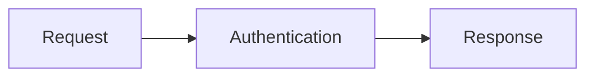

# Mermaid

Add interactive diagrams to your API descriptions with the optional `@scalar/mermaid-plugin` package. Use Mermaid code fences to illustrate request flows, authentication sequences, and relationships alongside your API documentation.

## Enable Mermaid

Install the API Reference and the Mermaid plugin:

```sh
npm install @scalar/api-reference @scalar/mermaid-plugin
```

Import the plugin and register it when you create the API reference. The page must contain an element with `id="app"`:

```typescript
import { createApiReference } from '@scalar/api-reference'
import { mermaidPlugin } from '@scalar/mermaid-plugin'

createApiReference('#app', {
  url: '/openapi.yaml',
  plugins: [mermaidPlugin()],
})
```

Mermaid is opt-in. Without the plugin, Mermaid fences remain ordinary code blocks. With the plugin enabled, Mermaid loads only when it encounters a Mermaid fence.

## Write a diagram

Add a fenced code block with the language `mermaid` to a Markdown description:

````markdown

````

For example, this complete API description places a diagram in the introduction:

````yaml
openapi: 3.1.0
info:
  title: Order API
  version: 1.0.0
  description: |
    Follow a request through the API:

    ```mermaid
    flowchart LR
      Request --> Authentication --> Response
    ```
paths: {}
````

Serve this document at `/openapi.yaml`, or change `url` in the setup example to its location.

The plugin enhances Markdown descriptions throughout the API reference, including operations, parameters, responses, models, summaries, and the embedded API client. Invalid diagrams keep their source visible instead of displaying a diagram. During server-side rendering, the source remains a code block until the browser hydrates the reference.

## Explore a diagram

- Use **Zoom in** and **Zoom out** to change the scale.
- Use **Reset view** to restore the original scale and position.
- Drag the diagram to pan, or focus it with the keyboard and use the arrow keys.

## Styling

The viewer frame and controls follow Scalar's theme. The drawing surface stays light in both light and dark mode to keep Mermaid's default palette legible.

Override the drawing surface with `--scalar-mermaid-canvas-background`. Choose a color that works with Mermaid's light palette:

```css
.scalar-app {
  --scalar-mermaid-canvas-background: #f8fafc;
}
```

## Rendering and security

The plugin renders diagrams in the browser after Scalar sanitizes the Markdown. It inserts generated SVG using Mermaid's sanitizer as the security boundary for diagram output. Enabling the plugin adds Mermaid as a rendering and sanitization dependency.

Mermaid runs with `securityLevel: 'strict'`, which sanitizes diagram content and disables callbacks. Keep this setting intact if another Mermaid integration runs on the same page, and keep the dependency updated.
